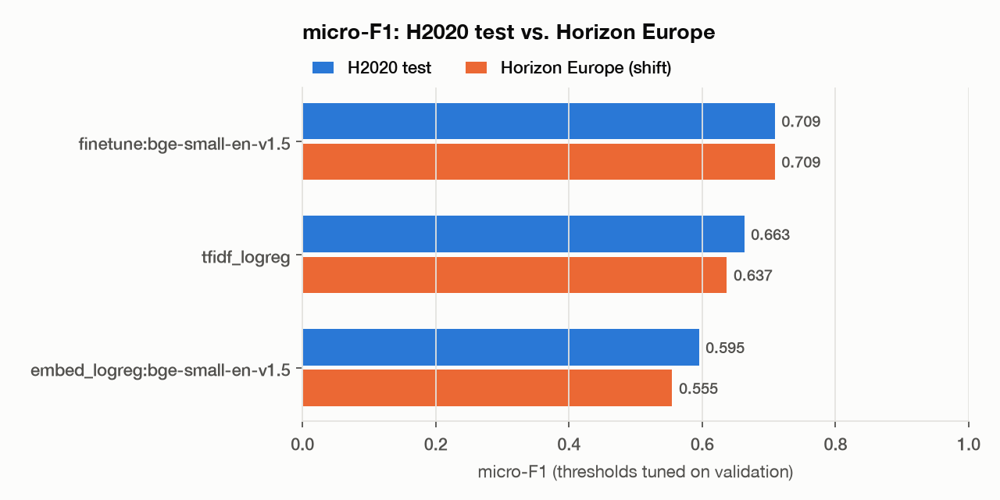
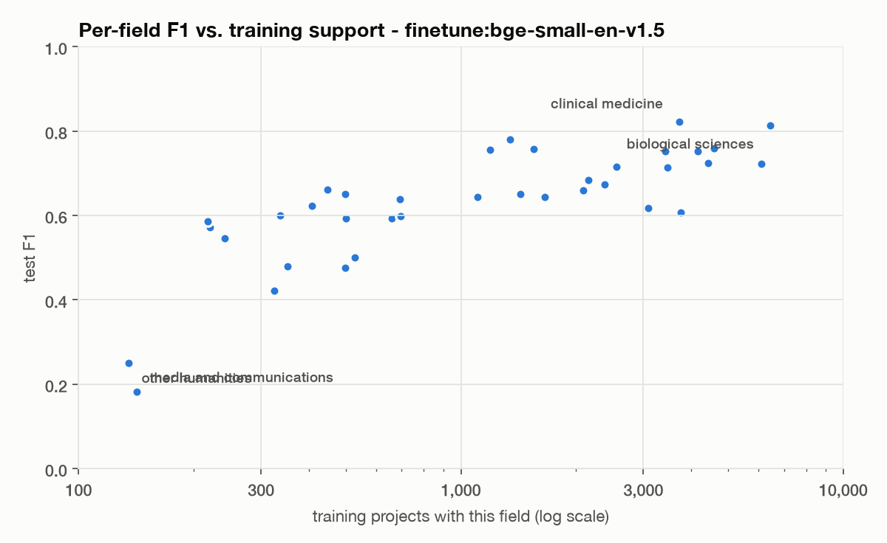
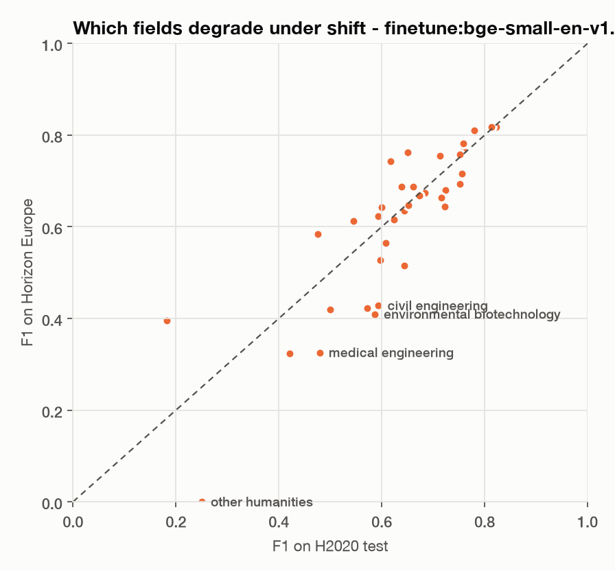

# CORDIS field classifier

[](https://github.com/imperiobaal69-web/cordis-field-classifier/actions/workflows/ci.yml)

Multi-label text classification of **52,000 EU-funded research projects** into
the scientific fields they belong to, built as a production ML system rather
than a notebook: a parser that recovers rows standard tools silently lose,
leakage-safe splits, four models compared under one protocol, per-field
thresholds, calibration, an evaluation on a *later* funding programme, a typed
HTTP API, a container and CI that tests all of it.

**Task.** Given a project's title and objective, predict its EuroSciVoc
second-level fields (37 classes, 2.6 per project on average) - e.g.
*natural sciences / chemical sciences* + *engineering and technology / materials
engineering*.

**Data.** Official CORDIS bulk exports (data.europa.eu): Horizon 2020
(2014-2020) for training and model selection, **Horizon Europe (2021-2027) held
out entirely** to measure how the model ages.

## Results

<!-- results:start -->
| Model | H2020 test micro-F1 | macro-F1 | Horizon Europe micro-F1 | macro-F1 | Calibration (ECE) | Train time | Inference |
| --- | ---: | ---: | ---: | ---: | ---: | ---: | ---: |
| **Fine-tuned bge-small** (33M params) | **0.709** | **0.627** | **0.709** | **0.608** | 0.006 | 73 min, M4 GPU | 11 ms/doc, M4 GPU |
| TF-IDF + logistic regression | 0.663 | 0.563 | 0.637 | 0.532 | 0.013 | 82 s, CPU | 0.3 ms/doc, CPU |
| Frozen bge-small embeddings + logistic regression | 0.595 | 0.495 | 0.555 | 0.437 | 0.005 | 11 min | 26 ms/doc |
| Label-frequency prior (no text) | 0.219 | 0.106 | 0.185 | 0.089 | 0.002 | - | - |

H2020 test: 3,261 projects. Horizon Europe: 20,147 projects, never seen in training
or selection. Thresholds, hyper-parameters and the fine-tuning epoch were chosen on
H2020 validation only.
<!-- results:end -->



What the numbers say:

1. **Fine-tuning is what makes the encoder useful.** The same 33M-parameter
   encoder scores 0.595 frozen and 0.709 fine-tuned. Frozen general-purpose
   sentence embeddings lose to a well-regularised TF-IDF on fine-grained topic
   labels; adapting them end-to-end wins by 4.6 points in-distribution.
2. **The fine-tuned model ages better.** On the later programme TF-IDF loses 2.6
   points of micro-F1; the fine-tuned model loses none (macro-F1 drops 1.9 points,
   so rare fields still suffer). Both still predict more fields per project (2.47)
   than the newer labelling assigns (2.13).
3. **Thresholds are not the fix for shift.** Re-tuning per-field thresholds on up
   to 4,042 labelled Horizon projects moves micro-F1 by at most 0.7 points for
   either model ([adaptation study](reports/adaptation.md)); the threshold-free
   ranking metric drops too (macro PR-AUC 0.665 -> 0.622). Retraining is the remedy.
4. **Rare fields are the weak spot.** F1 rises with training support; five fields
   stay below 0.5, all with under 400 training projects or catch-all "other ..."
   labels.
5. **Some errors are label noise.** The seeded error sample includes a drug
   project labelled *electrical engineering* and a photonics project labelled
   *economics and business*. Most CORDIS field labels are not human-validated, so
   scores measure agreement with CORDIS's labelling, not ground truth.
6. **Cost matters.** TF-IDF runs at 0.3 ms per document on a CPU; the fine-tuned
   model needs 11 ms even on the M4's GPU, plus PyTorch in the image. The Docker
   image serves TF-IDF by default; the fine-tuned model is one flag away for
   accuracy-critical use.

Full tables: [`reports/leaderboard.md`](reports/leaderboard.md),
per-field metrics in [`reports/metrics/`](reports/metrics),
[`reports/error_analysis.md`](reports/error_analysis.md),
[`reports/adaptation.md`](reports/adaptation.md) and the
[model card](MODEL_CARD.md).

<p>
  
  
</p>

## Engineering decisions

| Problem | Decision | Where |
| --- | --- | --- |
| The CORDIS CSVs escape quotes inconsistently. `pandas.read_csv` drops **285 of 35,389** H2020 projects and returns a truncated or shifted objective for **960 more** - without raising. | A reader built on the two invariants the export does keep (record-start shape, `";"` field boundary), which checks the field count of every record and fails loudly if the format changes. | [`cordis.py`](src/fieldclf/cordis.py), [tests](tests/test_cordis.py) |
| Some descriptions are duplicated across projects; a random row split leaks them from train into test. | Split by a hash of the normalised text (group split), stable across export refreshes. Horizon projects whose text appears in H2020 are removed from the shift set. | [`dataset.py`](src/fieldclf/dataset.py) |
| Accuracy on data from the same period overstates real-world performance. | Horizon Europe is never used for training, tuning or selection - only reported. | [`experiment.py`](src/fieldclf/experiment.py) |
| One global 0.5 cut-off is wrong for 37 labels with 100x different frequencies. | Per-label thresholds that maximise validation F1; labels with fewer than 20 validation positives fall back to the global optimum; ties resolve to the centre of the plateau, not its edge. | [`metrics.py`](src/fieldclf/metrics.py) |
| Every project has at least one field, so an empty prediction is always wrong. | If no label passes its threshold, the arg-max label is returned. | `decide()` |
| The API exposes scores, so they must mean something. | Expected calibration error is reported for every model; the fine-tuned network gets post-hoc temperature scaling fitted on validation. | [`finetune.py`](src/fieldclf/finetune.py) |
| The first full fine-tuning epoch barely beat the label-frequency baseline (validation macro PR-AUC 0.22). | Diagnosed: the stock sequence-classification head routes through a BERT pooler this encoder never trained. Replaced with a linear head on the [CLS] vector, its bias initialised to each label's log-odds and a 10x learning rate for the new head. Epoch 1 went to 0.61. | [`finetune.py`](src/fieldclf/finetune.py) |
| Fine-tuning on Apple MPS grew to 13 GB within one epoch. | Diagnosed as per-shape graph caching from dynamic padding; fixed-length batches keep it at ~1 GB. | `FineTuned.fit` |
| A model artefact must be loadable without the training code's state. | One `Classifier` object (model + label list + thresholds + metadata); transformer weights stored in their native format beside the pickle. | [`predictor.py`](src/fieldclf/predictor.py) |

## Run it

Requires Python 3.12 and [uv](https://docs.astral.sh/uv/).

```sh
make setup        # core + dev dependencies
make data         # download the CORDIS exports (~90 MB) and build the dataset
uv run fieldclf train tfidf      # ~2 minutes on a laptop CPU
uv run fieldclf predict "Novel perovskite materials for tandem solar cells with improved stability"
```

```json
{
  "fields": [
    "engineering and technology/environmental engineering",
    "engineering and technology/materials engineering"
  ],
  "scores": [
    {
      "field": "engineering and technology/environmental engineering",
      "score": 0.7698,
      "threshold": 0.25
    },
    {
      "field": "engineering and technology/materials engineering",
      "score": 0.3937,
      "threshold": 0.22
    },
    {
      "field": "natural sciences/chemical sciences",
      "score": 0.1973,
      "threshold": 0.23
    }
  ]
}
```

Serve it:

```sh
uv run fieldclf serve --model-dir artifacts/tfidf_logreg
curl -s localhost:8000/predict -H 'content-type: application/json' \
  -d '{"texts": ["Deep learning for early detection of diabetic retinopathy"], "top_k": 3}'
```

Serve the fine-tuned model instead (needs the `finetune` extra):

```sh
uv run fieldclf serve --model-dir artifacts/finetune__bge-small-en-v1.5
```

Or as a container (TF-IDF model, no PyTorch in the image):

```sh
make image && docker run -p 8000:8000 fieldclf
```

Reproduce every number in this README: `make setup-all && make train && make figures`
(about two hours on an Apple M4, most of it fine-tuning).

## Tests and CI

`make test` runs 25 tests that need no network and no real data: synthetic
archives reproduce the real export format, including the malformed quoting. They
cover the parser (and document the pandas data loss), split determinism and
leakage, threshold tuning, calibration, the end-to-end train -> save -> load ->
serve path and the API's input validation. CI runs ruff, mypy and the tests,
then trains a smoke model, builds the Docker image and calls the running
container.

## Layout

```
src/fieldclf/
  cordis.py       robust reader for the CORDIS exports
  dataset.py      labels, group split, shift set, label vocabulary
  models.py       prior, TF-IDF + logistic regression, frozen embeddings + logistic regression
  finetune.py     end-to-end fine-tuning (plain PyTorch loop), temperature scaling
  metrics.py      thresholds, F1 / PR-AUC, calibration
  experiment.py   one protocol for every model; writes reports/metrics/*.json
  predictor.py    the deployable unit
  serve.py        FastAPI service
  cli.py          fieldclf download | build | train | leaderboard | predict | serve
scripts/          run_experiments.py, make_report.py, smoke_model.py
reports/          every number and figure above, generated
```

## Limitations

The labels are CORDIS's own EuroSciVoc assignments, most of them not
human-validated, so scores measure agreement with that labelling rather than
truth. Rare and catch-all fields are weak. See the [model card](MODEL_CARD.md).

## Data licence

CORDIS data (c) European Union, reused under the European Commission reuse
notice (Decision 2011/833/EU). Code: MIT.
